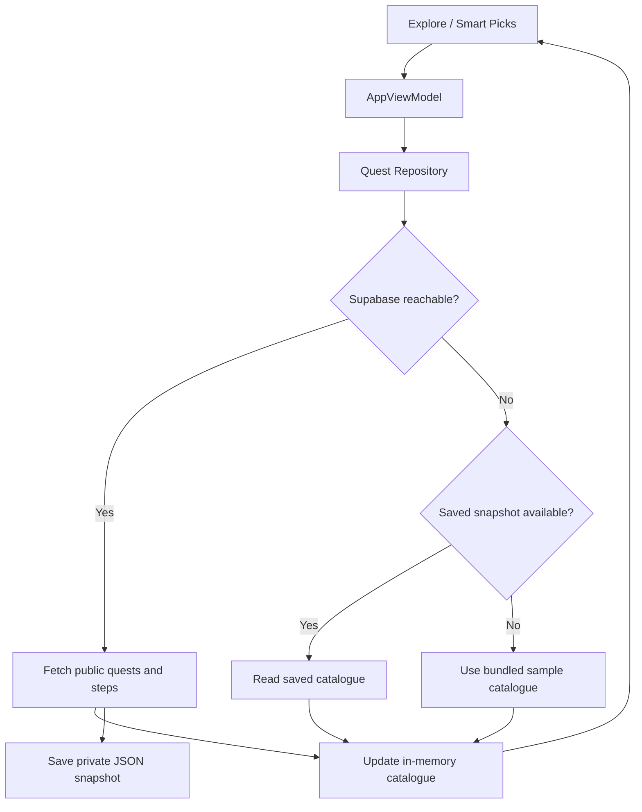

# Sprint 3 — Sebastián Maldonado (Kotlin)

This is a technical evidence page for Sebastián's individual work. It is **not** a claim that the whole Kotlin subgroup has completed Sprint 3.

## 1. Previous work and new assignment

- **Sprint 2:** BQ5 Personalized Quest Recommendation, Smart Picks, Explore filters, `Not for me`, reactive `StateFlow` UI, and Kotlin integration with the shared recommendation RPC.
- **Sprint 3:** preserve the quest catalogue between sessions, demonstrate asynchronous work, and implement **BQ12 Sponsored Quest Performance (Type 4)** as a new BQ from Sprint 1.
- The previous BQ5 remains Sprint 2 evidence; it is **not** counted again as a new Sprint 3 BQ.

## 2. Saving quests for offline use

**Issue:** https://github.com/Moviles-SEC-2-G25/Sidequests-Kotlin/issues/12

**Implementation branch:** `feature/sprint3-save-quests-offline`

### Data and storage choice

The last successful download of the **public** quest catalogue and step definitions is saved as JSON in the app's **private internal file storage**. This saves the real downloaded quest content rather than only falling back to compiled sample quests. Account credentials, private history and photo files do not belong in this catalogue file.

We selected a small JSON snapshot because the public catalogue is downloaded and read as one small unit. The current use case does not require relational queries, migrations or an additional database library; Room would add complexity without an evidenced benefit at this stage. If future catalogue size or update frequency grows materially, the storage decision should be re-evaluated.

The repository performs I/O using `withContext(Dispatchers.IO)`. It writes to a temporary file and replaces the previous snapshot only after the new JSON is written. An empty downloaded catalogue is rejected; malformed stored JSON is ignored instead of crashing the app.

### Relevant source

- `app/src/main/java/com/sidequests/app/data/LocalQuestCatalogueStore.kt`
- `app/src/main/java/com/sidequests/app/data/SidequestsRepository.kt`
- `app/src/main/java/com/sidequests/app/ui/AppViewModel.kt`
- `app/src/main/java/com/sidequests/app/ui/AppViewModelFactory.kt`
- `app/src/test/java/com/sidequests/app/data/LocalQuestCatalogueStoreTest.kt`

### Cache and retrieval policy

1. When online, the app requests quests and steps from Supabase.
2. After a successful response, it updates the in-memory catalogue and attempts to save the same snapshot privately.
3. If a later remote refresh fails, the app attempts to restore the saved snapshot and uses it for Explore.
4. If no saved snapshot exists, the existing bundled sample quests remain the fallback, explicitly identified as samples.
5. A successful subsequent refresh replaces the snapshot. There is currently no TTL; successful remote refresh is the invalidation/replacement mechanism.

**Limitations:** The system does not yet provide full offline write/sync for every action. Showing saved read-only catalogue data is not the same as queuing quest progress, photo uploads or analytics events.

## 3. Eventual connectivity scenarios (Sebastián's catalogue / recommendation flow)

| ID | Event and context | Intended system response | Antipattern avoided | Cache / retrieval strategy | Storage and saved data | Evidence status |
| --- | --- | --- | --- | --- | --- | --- |
| EC-S1 | The user opens Explore after a successful download, but Supabase is unreachable | Recover the saved catalogue and show its saved/offline source | Blank screen, pretending stale data is fresh | Remote-first, last saved snapshot fallback | Private JSON file containing public quests and steps | Source + unit tests; phone pending |
| EC-S2 | The app restarts without connectivity after downloading quests earlier | Read the saved catalogue from private storage during refresh fallback | Losing the full catalogue on every restart | Persistent snapshot reopened on demand | Private JSON file | Persistence unit test; physical relaunch pending |
| EC-S3 | The user changes filters while recommendations cannot be fetched | Reuse the locally available catalogue with local recommendation ranking | Indefinite loading or a crash when the remote recommender fails | Existing repository ranking and remote recommendation fallback | Catalogue in memory, backed by saved snapshot | Source review; physical demonstration pending |
| EC-S4 | The remote refresh succeeds after an outage | Replace the previous catalogue with the new valid response | Keeping stale data indefinitely after recovery | Refresh-on-success write-through to private file | Updated quests and steps | Replacement unit test; phone reconnection pending |

### Connectivity diagram

This diagram describes **catalogue reads and local recommendation fallback**, not a general-purpose offline mutation queue.

## 4. Concurrency / multithreading

The Kotlin client already uses `viewModelScope.launch` to start asynchronous work owned by `AppViewModel`, and repository operations use `withContext(Dispatchers.IO)` for network requests and private-file read/write. `StateFlow` carries the resulting UI state to Compose.

- **Why:** network and disk I/O must not block the main/UI thread.
- **Lifecycle:** ViewModel coroutine work follows the ViewModel scope; cancellation is propagated in the catalogue refresh path.
- **Evidence:** source above and GitHub Android CI unit test/build result.
- **Still required:** a real-device demonstration of responsive navigation under degraded connectivity and explanation of the coroutine dispatcher choices for other Kotlin members' flows.

## 5. BQ12 — Sponsored Quest Performance (new Sprint 3 BQ)

**Sprint 1 question (Type 4):** What is the acceptance and completion rate of sponsored Side-Quests compared with non-sponsored ones, segmented by business category and by the user's declared interests?

**Owner:** Sebastián Maldonado

**Why:** Sidequests' proposed revenue model relies on sponsored activities. These metrics assess the suitability of sponsorship to the student experience, including activity engagement and follow-through.

**Analytics implementation draft:** https://github.com/Moviles-SEC-2-G25/Sidequests-Analytics/pull/8

- Uses `recommendation_shown` events and subsequent `quest_accepted` / `recommendation_accepted` events **in the same session** for recommendation acceptance.
- Uses `public.user_quests` to count accepted attempts and completed attempts, including catalogue/direct acceptances.
- Groups metrics by sponsorship flag, quest **activity** category, and whether currently declared interests match the quest category/tags.
- The existing Python pipeline can store results as BQ12 in `analytics.bq_results`.

**Read-only live SQL validation on October 26, 2026:** Query executed against the shared Sidequests Supabase database. In the preceding 30 days, the current query produced 135 non-sponsored recommendation impressions, 13 same-session matched accepted impressions, 38 accepted non-sponsored attempts, and 15 completed non-sponsored attempts. There was only one sponsored quest and no sponsored attempts in this window. **No sponsored vs non-sponsored conclusion is supported by these data.**

**Important limitations:**
- `quests.category` means **activity category**. The backend has no separate sponsor *business category*; that part of the original BQ needs an explicit schema/data decision.
- Declared interests are the **current preferences**, not a historical snapshot from the moment of each event.
- No server-side batch execution storing a BQ12 result, no authenticated mobile BQ12 results screen, and no real-phone end-to-end demo have been verified. The new BQ is **not yet fully delivered**.
- Never embed database or service-role credentials in Android.

## 6. Tests and evidence

- [x] Kotlin Android CI unit tests passed after retry of one unrelated intermittent JVM dispatcher/Looper failure.
- [x] Kotlin debug APK assembled in GitHub Actions.
- [x] Analytics tests passed on GitHub Actions for the BQ12 draft.
- [x] BQ12 SQL ran against the real shared PostgreSQL database in a read-only query.
- [ ] Catalogue offline/relaunch/reconnect validated on a physical Android device.
- [ ] New BQ12 results executed/stored by the real batch pipeline and displayed from the mobile app.
- [ ] Sponsored business category/adequate sample data added/validated.
- [ ] Final reviewed PRs integrated into the official main branches.
- [ ] Firebase distribution to the course TAs documented.

**PR for this offline work:** https://github.com/Moviles-SEC-2-G25/Sidequests-Kotlin/pull/19

## 7. Individual ownership boundary

This page covers Sebastián's Sprint 3 work. Lex and Julián must each select and implement **a different new Business Question**, provide their own storage/cache/threading/connectivity implementation evidence and contribute their own commits, issues, PRs and testing. Neither their Sprint 2 BQs (BQ6/BQ10) nor Sebastián's prior BQ5 can be reused as a new Sprint 3 BQ without an explicit instructor interpretation allowing it.
